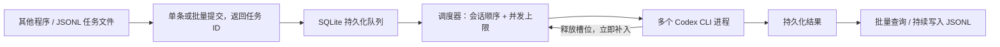

# Codex API 服务

自动启动本机 `codex exec`，输入文字和图片，返回最终回答。使用本机已有的 Codex 登录；续聊通过 `codex exec resume <thread_id>` 恢复真实上下文。


## 几千任务：使用异步队列

v2 提供持久化任务队列。调用方提交后立即得到任务 ID，不必保持 HTTP 连接等待模型；服务器有空闲槽位就取下一个可执行任务，无需等待整批完成。默认最多同时执行 20 个 Codex 任务，并发配置范围为 1–20，最多接受 10000 个未完成任务。



这里的 batch 是 HTTP 提交分块和任务调度。Codex 由上游服务推理，本程序无法控制 GPU 的 token batching 或 KV cache；实际模型吞吐取决于账户额度、模型速度和输入输出长度。模拟队列压测数据不代表真实模型吞吐。

### 最简单的提交与取结果

```python
from api_server.client import CodexClient

with CodexClient() as client:
    job = client.submit(
        "请描述图片。",
        images=[client.image("photo.png")],
        idempotency_key="dataset-001-image-0001",  # 同一任务重发时沿用此键
    )
    print(job["id"])  # 此时任务可能还在排队，可先去提交其他任务

    result = client.wait(job["id"])  # 持续查询状态，直到任务结束
    if result["status"] == "completed":
        print(result["response"]["answer"])
    else:
        print(result["status"], result["error"])
```

同样支持 `model`、`reasoning_effort`、`conversation_id`。新对话的 `conversation_id` 从任务完成后的 `response` 中取得。`client.get_job(id)` 只查询当前状态；`client.cancel(id)` 请求取消；`client.queue_stats()` 查看排队数、运行数和容量。

`client.wait()` 和 `client.iter_results()` 收集结果时，遇到临时连接错误或 HTTP 429/500/502/503/504 会退避重试查询，直到调用方设置的等待期限；401、404 等错误直接返回。查询重试不会重新执行模型任务。

### 一次处理几千条

可以用迭代器逐条生成请求，客户端自动按条数和请求字节数分块提交，并维护在途窗口，不会把全部图片载入内存。默认每块 JSON 不超过 30 MiB，为服务端 32 MiB 请求体上限预留空间：

```python
from api_server.client import CodexClient

requests = ({"prompt": f"用一句话解释编号 {i}。"} for i in range(3000))
with CodexClient() as client:
    for result in client.iter_results(
        requests,
        batch_size=100,       # 每次 HTTP 提交最多 100 条
        max_in_flight=500,    # 本调用方最多 500 条在服务端等待/执行
        timeout=86400,
        run_id="dataset-run-001",
    ):
        # 按完成情况返回；index 对应原始输入顺序，失败也会返回。
        print(result["index"], result["status"], result["response"])
```

现成提交程序 [example_queue.py](example_queue.py) 会逐行读取 JSONL，结果完成一条便追加保存一条：

```bash
api_server/.venv/bin/python api_server/example_queue.py \
  --input tasks.jsonl --output results.jsonl \
  --batch-size 100 --max-in-flight 500 --run-id dataset-run-001
```

`tasks.jsonl` 每行是一个请求；图片可以使用 Base64 或服务器可访问的路径：

```json
{"prompt":"描述图中的物体", "images":[{"path":"/服务器路径/a.png"}]}
{"prompt":"把 apple 翻译成中文"}
```

中断后可使用相同的 `run_id`、输入顺序和 `batch_size` 重新运行，已接受的提交会通过幂等键返回原任务。输出文件采用追加模式，恢复运行可能重复追加结果，按 `(run_id,index)` 去重。新的数据集或不同参数使用新的 `run_id`。

### 调度与恢复语义

- 同步 `/v1/chat`、`/v1/batch` 和异步任务共用队列与全局并发上限。
- 采用可执行任务优先的 FIFO；同一会话按接受顺序串行，其他会话可以继续执行。需要继续新建会话时，先等待首轮完成并取得会话 ID。
- 图片在接受提交前完成校验和快照；排队期间原图片被移动或删除，不影响已接受的任务。
- 单次异步批量最多 1000 条，整批接受或整批拒绝。容量计入排队、运行和正在取消的任务；超出数量/字节容量返回 429 和 `Retry-After`。单个提交自身超过容量返回 413。
- `Idempotency-Key` 覆盖整次提交；相同键、相同请求返回原任务，相同键、不同请求返回 409。客户端窗口提交会对限流或暂时的提交连接故障沿用原键重试。
- 服务重启后恢复 `queued` 任务；执行中被中断的任务标记 `interrupted`，不会自动重跑。模型错误与执行超时记录为 `failed`，可查看 `status_code` 和 `error`。
- 排队时间不计入 `CODEX_TIMEOUT_SECONDS`，该值限制每轮执行时长。客户端等待超时或断开连接不会取消已接受任务。
- 取消排队任务不会调用模型；取消运行任务会终止本地 Codex 进程及其子进程。上游可能已处理部分输入；若恰好完成，最终状态可能是 `completed`。
- 队列数据保存在 `runtime/jobs.sqlite3`，等待图片保存在 `runtime/job-inputs/`。完成后释放队列输入；结果、幂等记录和会话历史会保留并占用磁盘，当前不自动清理。持续大规模运行请监测磁盘使用。

修改并发后重启，例如：

```bash
CODEX_MAX_CONCURRENCY=8 CODEX_MAX_PENDING=10000 bash api_server/start.sh
```

`batch_size` 控制提交分块；`max_in_flight` 控制调用程序的在途任务数；`CODEX_MAX_CONCURRENCY` 才是实际 Codex 并发数。需要根据真实任务的延迟与失败率调整并发，不要把提交分块大小当作模型并发。

### 查看运行速度

```python
with CodexClient() as client:
    stats = client.queue_stats()
    print(stats["pending"], stats["active_workers"])
    print(stats["recent"])
    print(stats["history_database"])
```

`recent` 统计最近 60 秒完成的任务，包括完成数、失败数、平均排队时间和平均执行时间。`completed_per_second` 固定用最近完成数除以 60；刚启动时也采用完整 60 秒分母，没有样本时平均时间为 `null`。

`history_database` 显示本次服务启动以来的历史数据库事务数、操作数及单次事务最大操作数。并发历史写入采用约 2ms 的合并窗口，每次最多 128 个操作共用一次提交；每个操作仍通过 savepoint 隔离，只有数据库提交成功才通知调用方。共享文件系统上的持久化开销因此可以被多个任务分摊。

如果数据库持续无法保存结果，服务会暂时占用对应执行槽位并重试保存；关闭服务时会停止无限重试，恢复启动后将未确认结果标记为 `interrupted`。

## 启动

需要 Linux、Python 3.11+、支持 `exec --json` / `exec resume --image` 的 Codex CLI。本机实现时 CLI 版本为 0.154.0。

在 `data_pipeline` 目录执行：

```bash
bash api_server/setup.sh
codex login status
# 如果尚未登录：codex login
bash api_server/start.sh
```

默认地址 `http://127.0.0.1:8000`，交互文档 `http://127.0.0.1:8000/docs`。启动脚本在前台运行，Ctrl+C 停止。依赖已安装到本目录 `.venv` 时可直接启动。

`setup.sh` and `start.sh` select `API_SERVER_PYTHON`, `PIPELINE_PYTHON`,
then the package's `.python-path`, falling back to `.venv/bin/python` in this package.
A missing interpreter is an error. Runtime data defaults to the package's `runtime`
directory; override it with `API_SERVER_DATA_DIR`. Workspace roots default to the
parent directory of `api_server`; override with `CODEX_IMAGE_ROOTS` and `CODEX_WRITE_ROOTS`.
Authentication is read from the current user's `~/.codex/auth.json`, or `CODEX_AUTH_FILE`.
Set `API_SERVER_TOKEN` in the environment; do not store secrets in shared configuration.
`launch_config.json` only contains the generic concurrency setting.

For background execution:

```bash
mkdir -p api_server/runtime
tmux new-session -d -s codex-api-server 'bash api_server/start.sh >> api_server/runtime/server.log 2>&1'
tmux attach -t codex-api-server
# attach 后 Ctrl+B、D 脱离；Ctrl+C 停止服务。
# 或从外部停止：tmux send-keys -t codex-api-server C-c
```

开放给其他机器时设置访问密钥：

```bash
export API_SERVER_HOST=0.0.0.0
export API_SERVER_TOKEN='替换为自己的随机长密钥'
bash api_server/start.sh
```

随后请求添加 `Authorization: Bearer <密钥>`。这是使用服务器 Codex 账户运行任务的受信任调用接口；只读沙箱仍可读取文件，不构成多租户隔离。外部网络请通过 HTTPS 反向代理访问。

## HTTP 接口

| 方法 | 路径 | 用途 |
|---|---|---|
| GET | `/health` | 服务存活、CLI 是否存在；不验证模型联网状态 |
| GET | `/v1/models` | 本机缓存中的模型 ID 和默认模型 |
| POST | `/v1/chat` | 一轮文字/图片请求，等待最终回答 |
| POST | `/v1/batch` | 最多 32 条请求；返回逐条结果 |
| POST | `/v1/jobs` | 异步提交一条，返回 HTTP 202 和任务 ID |
| POST | `/v1/jobs/batch` | 异步提交最多 1000 条，返回 `jobs` 列表 |
| GET | `/v1/jobs/{id}` | 任务状态/结果；`wait_seconds=0..30` 支持长轮询 |
| POST | `/v1/jobs/query` | 请求 `{"job_ids":[...]}`，批量查询最多 1000 条 |
| POST | `/v1/jobs/{id}/cancel` | 取消排队/运行中的任务 |
| GET | `/v1/queue` | 队列容量、状态计数、运行槽位和调度器状态 |
| GET | `/v1/conversations/{id}` | 会话及历史；支持 `limit`、`offset` |

本服务采用自己的请求格式，不是 OpenAI Chat Completions 协议。

### 新对话、模型选择

```bash
curl -sS http://127.0.0.1:8000/v1/models
curl -sS http://127.0.0.1:8000/v1/chat \
  -H 'Content-Type: application/json' \
  -d '{"prompt":"请记住：项目代号是 orange。", "new_conversation":true}'
```

可增加 `"model":"模型ID"` 和 `"reasoning_effort":"low"`。模型 ID 直接传给 Codex，由登录账户决定可用性；`/v1/models` 是缓存信息，并非实时可用性保证。不传模型时，新对话使用 `CODEX_MODEL` 或本机 Codex 配置。

响应示例（ID 和 token 数仅为示例）：

```json
{
  "conversation_id": "a1df3566-0443-4335-b15d-1c773abca57f",
  "thread_id": "a205f4fc-59e2-42d3-992d-77ec4891e473",
  "model": "your-model-id",
  "reasoning_effort": "low",
  "answer": "好的，我记住了。",
  "usage": {"input_tokens": 100, "output_tokens": 12},
  "elapsed_seconds": 2.8
}
```

`usage` 原样返回 Codex 的用量事件；恢复会话时可能是线程累计值，不保证是本轮增量。

### 多轮对话

```bash
curl -sS http://127.0.0.1:8000/v1/chat \
  -H 'Content-Type: application/json' \
  -d '{"prompt":"项目代号是什么？", "conversation_id":"替换为返回的conversation_id"}'
```

- 不带 `conversation_id`：每次创建独立新对话。
- 带 `conversation_id`：继续指定对话，省略模型/推理强度时沿用上轮显式设置；也可以传新模型切换。
- `new_conversation` 可省略；`true` 不能同时传 ID，`false` 必须传 ID。
- 服务只接受自己创建的会话 ID。API 的 `conversation_id` 与 Codex 的 `thread_id` 是两个不同 ID。
- API 会话映射和历史保存在 `runtime/conversations.sqlite3`，Codex 上下文保存在当前 `CODEX_HOME`。重启后继续对话需要同时保留两处数据及原账户。

### 图片

`images` 为数组，每项只允许一种来源：

```json
{"prompt":"描述这些图片", "images":[{"path":"/服务器上的绝对路径/example.png"}]}
```

或者传 Base64（支持 `data:image/png;base64,...` 格式）：

```json
{"prompt":"描述图片", "images":[{"base64":"图片文件的Base64编码"}]}
```

本地路径指服务器文件，必须位于 `CODEX_IMAGE_ROOTS` 范围内；客户端图片请使用 Base64 或下方 Python 客户端。支持静态 PNG、JPEG、WebP，每次最多 8 张，单张 10 MiB，总计 20 MiB；整个 HTTP 请求体最多 32 MiB。续聊时也可传图片。请求临时文件会清理；Codex 自身可能在会话记录中保存输入。

### 批量调用

```bash
curl -sS http://127.0.0.1:8000/v1/batch \
  -H 'Content-Type: application/json' \
  -d '{"requests":[{"prompt":"把 apple 翻译成中文"},{"prompt":"把 orange 翻译成中文"}]}'
```

返回 `{"results":[{"index":0,"ok":true,"response":{...}}, ...]}`。单项失败返回 `ok:false`、`status_code` 和 `error`，不会中断其他项；结果保持输入顺序。同一会话的多条输入按数组顺序执行，其他会话并发执行。已有会话的一轮失败后，后续项仍会继续执行。

这是兼容原调用方式的同步批量接口；客户端须等待整个批次结束。几千任务请使用上面的 `/v1/jobs` 或 `/v1/jobs/batch` 异步接口。同步调用仍需为客户端/反向代理配置足够长的超时。

## Python 客户端

可直接运行带中文注释的 [example.py](example.py)：

```bash
api_server/.venv/bin/python api_server/example.py --prompt "你好"
api_server/.venv/bin/python api_server/example.py --example conversation
api_server/.venv/bin/python api_server/example.py --example image --image /path/to/photo.png
api_server/.venv/bin/python api_server/example.py --example batch
api_server/.venv/bin/python api_server/example.py --example models
```

增加 `--model 模型ID` 可选择模型，`--base-url http://服务器地址:8000` 可指定服务地址。鉴权密钥从 `API_SERVER_TOKEN` 环境变量读取。

从 `data_pipeline` 下运行，或把该目录加入 `PYTHONPATH`：

```python
from api_server.client import CodexClient

with CodexClient(token=None) as client:  # 启用鉴权时填写 token
    print(client.models())
    first = client.chat("记住数字 42", new_conversation=True)
    print(first["answer"])
    second = client.chat("刚才的数字是多少？",
                         conversation_id=first["conversation_id"])
    print(second["answer"])

    # 本地图片自动编码并发送到服务器
    # result = client.chat("描述图片", images=[client.image("example.png")])

    results = client.batch([{"prompt":"1+1=?"}, {"prompt":"2+2=?"}])
    for item in results:
        print(item)
```

## 配置

通过环境变量配置；不会自动读取 `.env`。`start.sh` 的配置优先级为当前环境变量、
私有 `launch_config.json`、启动器默认值。应用与启动器默认并发均为 20，
仅允许设置为 1–20；0（无限制）和超过 20 的配置会报错。运行数据和解释器路径见上方启动说明。

| 变量 | 默认值 | 说明 |
|---|---|---|
| `API_SERVER_HOST` | `127.0.0.1` | 监听地址 |
| `API_SERVER_PORT` | `8000` | 监听端口 |
| `API_SERVER_TOKEN` | 空 | Bearer 密钥；启动脚本监听非本机地址时必填 |
| `CODEX_BIN` | `codex` | CLI 命令/绝对路径 |
| `CODEX_HOME` | `~/.codex` | Codex 配置、认证及上下文目录 |
| `CODEX_MODEL` | Codex 配置 | 新会话默认模型 |
| `CODEX_MAX_CONCURRENCY` | `20` | 最大同时运行的 Codex 进程数，仅允许 1–20 |
| `CODEX_MAX_PENDING` | `10000` | 排队、运行、取消中的任务总上限 |
| `CODEX_MAX_PENDING_BYTES` | `536870912` | 未完成任务的文本/图片输入总字节上限（512 MiB） |
| `CODEX_TIMEOUT_SECONDS` | `0` | 默认不限制执行时长；显式设置正数才启用执行超时，不包含排队等待 |
| `CODEX_IMAGE_ROOTS` | `data_pipeline` 绝对路径 | 本地图片允许根目录，Linux 下用 `:` 分隔 |
| `API_SERVER_DATA_DIR` | `api_server/runtime` | 数据和临时文件目录 |
| `API_SERVER_PYTHON` | `.python-path` 中的本地解释器 | 启动解释器；未设置时先检查 `PIPELINE_PYTHON` |

只运行一个 Uvicorn worker；服务使用异步子进程实现并发。同一数据目录使用进程锁阻止多 worker 造成会话交叉写入。普通请求的 Codex 在 `runtime/workspace` 下运行，显式使用只读沙箱与 `approval_policy=never`，仍加载本机 Codex 配置和已配置的工具。

### 2.2：预创建对话与指定写入工作区

- `POST /v1/conversations`：不调用模型，分配 `conversation_id`。首轮调用使用此 ID；
  之后通过同一个 ID 续聊。没有执行任何轮次的预创建对话可以直接开始首轮。
- `GET /v1/capabilities`：返回对话预创建能力及允许的 `workspace_write_roots`。
- `/v1/chat` 和 `/v1/jobs` 请求可增加 `workspace_dir`（已有的服务端绝对目录）。
  服务验证其位于 `CODEX_WRITE_ROOTS` 的子目录，并将该目录设为 Codex 的工作区，
  使用 `workspace-write`、`approval_policy=never`。额外可写根目录清空，临时目录
  不作为额外写入区域，沙箱网络关闭。未提供此字段的请求仍为只读。
- `CODEX_WRITE_ROOTS` 通过 `start.sh` 启动时默认为当前 `data_pipeline` 及同级的 `output`；
  直接启动 Uvicorn 时默认为 `data_pipeline`。多个目录用 `:` 分隔，
  空值禁用写入请求。此接口面向受信任调用方，与现有 Codex 账户共享读取权限和工具。

Python 客户端对应方法为 `create_conversation()`、`capabilities()`，以及
`chat(..., workspace_dir=...)` / `submit(..., workspace_dir=...)`。
图片重建调用方式见 [IMAGE_TO_BLENDER.md](../IMAGE_TO_BLENDER.md)。

### 2.3：按任务状态持续等待与进程活动查询

`client.wait()`、`client.iter_results()` 默认 `timeout=None`，一直查询到任务进入终态。
传入正数 `timeout` 仍可主动设置客户端等待上限。单次网络请求保留有限超时，临时查询
失败使用退避重试，不重新提交任务。`client.wait(..., on_update=callback)` 每次成功
查询后回调最新任务，`on_retry=callback` 在可重试的查询错误后回调异常。

服务端默认没有固定执行期限。运行中的任务通过 `activity` 返回 `process_alive`、
`pid`、`exit_code`、`elapsed_seconds`、`last_activity_seconds_ago`、`last_event`、
`event_count` 和 `worker_alive`。单条 GET 与批量 query 都支持这些实时字段；不持久化
进程活动历史。进程存活不代表一定有推理进展，静默也不代表卡死，不因静默时长自动取消。
进程退出后检查退出码、完成事件与最终响应；异常退出返回失败并释放队列槽位。

`/v1/capabilities` 返回 `execution_timeout_seconds`（默认 `null`）和 `job_activity=true`。

错误码：401 鉴权失败，404 会话/任务不存在，409 会话不可恢复或幂等键冲突，413 请求过大，422 输入非法，429 队列已满，502 Codex 失败，504 执行超时。具体 CLI 错误记录在服务器日志与受鉴权保护的历史接口。异步接口支持提交去重，但不能保证模型执行的 exactly-once；同步接口没有幂等键。

## 测试

```bash
api_server/.venv/bin/python -m pip install -r api_server/requirements-dev.txt
api_server/.venv/bin/python -m pytest api_server/tests -q

# 真实端到端测试：使用当前 Codex 登录，发出 4 次模型请求。
api_server/.venv/bin/python -m api_server.smoke_test
# 可通过 SMOKE_MODEL 指定测试模型。

# 对已启动的 HTTP 服务测试客户端、模型选择及续聊附图（2 次模型请求）
api_server/.venv/bin/python -m api_server.smoke_test --base-url http://127.0.0.1:8000
# 增加 --model 模型ID 可指定模型。

# 3000 个模拟任务的队列压测，不调用真实模型
api_server/.venv/bin/python -m api_server.benchmark_queue --jobs 3000 --concurrency 8

# 真实异步队列测试（4 次模型调用）
api_server/.venv/bin/python -m api_server.smoke_test --base-url http://127.0.0.1:8000 --queue
```

离线测试使用模拟 CLI 子进程和受控后端，覆盖原有接口、队列容量、并发上限、同一会话顺序、取消、重启恢复、幂等键竞争、客户端在途窗口和按字节拆批。真实测试覆盖图文、续聊及异步提交去重。对已运行 HTTP 服务的测试会保留任务/会话记录；不带 `--base-url` 的隔离测试只清理自身 API 临时数据，Codex 原生线程记录由 Codex 保留。


实现依据：[OpenAI 官方非交互模式文档](https://learn.chatgpt.com/docs/non-interactive-mode)、[CLI 命令参考](https://learn.chatgpt.com/docs/developer-commands?surface=cli)，并对照本机 `codex exec --help` 和 `codex exec resume --help`。
# Local session cleanup

`POST /v1/jobs/{job_id}/cleanup-session` deletes only the stopped job's local
Codex rollout JSONL files under `CODEX_HOME/sessions` and `archived_sessions`.
The endpoint authenticates like other job operations and rejects running jobs
or conversations with pending work. UUID filenames and session metadata must
both match. API job results and conversation history remain queryable; a
cleaned conversation cannot be resumed. Repeated cleanup is safe. Shared Codex
indexes/databases and other sessions are not changed.

The two configured top-level session directories may be symlinks to relocated
local storage. Cleanup resolves those roots before searching; it still rejects
symlinked rollout files and does not traverse symlinked directories inside them.
Dangling configured roots remain errors, so cleanup cannot silently lose track
of a session.

Clients must cancel timed-out jobs and observe a terminal status before cleanup.
Cancellation now retains the conversation mapping needed to identify the thread.
The capability is advertised as `local_session_cleanup: true`; restart the API
after updating its code. `data_pipeline/scripts_v2` invokes this endpoint on
completion and timeout; other clients retain their existing behavior.

Codex JSONL output is drained in 64 KiB chunks. Diagnostic events larger than
4 MiB are skipped with a warning instead of terminating the job; subsequent
thread/turn events are still processed. A missing completion event or a failed
process still fails the job. This handles oversized command output without
increasing per-job memory limits.

## GPU access inside task sandboxes

Linux GPU tasks can use the API-local `gpu_sandbox_bin/bwrap` wrapper while
retaining Codex's `workspace-write` filesystem boundary. This is opt-in through
`CODEX_GPU_SANDBOX_CONFIG` and only applies to requests with `workspace_dir`.
The user's global Codex installation, PATH and permission settings are not edited.

Configure on the GPU host, using the same Slurm allocation/environment as the API:

```bash
python3 -B gpu_sandbox.py --configure gpu_sandbox_config.json \
  --codex "$(command -v codex)"
```

The file pins the standalone Codex installation and lists only the GPUs returned
by `nvidia-smi`, intersected with `CUDA_VISIBLE_DEVICES`/`NVIDIA_VISIBLE_DEVICES`.
Display indices are translated into the actual `/dev/nvidiaN` minor numbers.
The only extra shared device nodes are `/dev/nvidiactl` and `/dev/nvidia-uvm`.
Neither all of `/dev` nor other GPUs are mounted. The config and wrapper must
remain outside the task's writable workspace. Reconfigure and verify after a
Codex upgrade, driver device-number change, host change or allocation change.

GPU compute also needs **local Unix IPC**: this NVIDIA driver binds an abstract
Unix socket during `cuInit()`. Codex's default offline filter blocks that call.
For GPU-enabled tasks, the backend keeps the original filesystem configuration
but sets the inner `sandbox_workspace_write.network_access=true` and disables
the optional network proxy. This does **not** provide external network access:
before the inner helper starts, our bubblewrap wrapper unshares the network
namespace and installs an additional, inherited seccomp filter. It permits
local Unix STREAM/SEQPACKET sockets, bind/listen and connected socketpair IPC,
while rejecting IP/Netlink/datagram sockets, all `connect`/`sendmmsg` calls,
`sendto` with a destination address (connected local sends remain allowed),
`io_uring` and `pidfd_getfd`. Direct connections to host Unix sockets
(including NVIDIA MPS) are also blocked. The current filter supports x86_64 Linux.
Do not enable the inner network flag independently of this wrapper.

Verify the actual shared renderer, not just `nvidia-smi`:

```bash
# Initialize once on each host, outside the restricted task sandbox.
.venv/bin/python -B \
  ../scripts_v2/render_tools/render_scene.py --init-pool --gpu-slots 3
.venv/bin/python -B tests/gpu_sandbox_smoke.py \
  --config gpu_sandbox_config.json \
  --render-tool ../scripts_v2/render_tools/render_scene.py
```

This makes no model requests. It verifies filesystem/protected-directory
denials, isolated networking, denied host Unix sockets, working local GPU IPC,
and an actual four-view Cycles render using AUTO → OptiX/CUDA. The existing
shared renderer controls the operator-configured concurrent slots per physical
GPU (three in the example above). Omit --gpu-slots to keep an existing limit.

To enable for subsequent API starts, add the absolute config path as the string
value of `CODEX_GPU_SANDBOX_CONFIG` in `launch_config.json`, or export that variable
before `./start.sh`. Restarting the API interrupts its running jobs; drain or
explicitly stop them first. Already-running Codex processes do not adopt the
new environment. Remove the variable and restart to restore the default sandbox.

Implementation references: [Codex's bwrap selection](https://learn.chatgpt.com/docs/sandboxing#prerequisites)
and the locally installed bundled `bwrap --help`. The GPU wrapper and IPC filter
are local customizations, not an upstream Codex GPU setting.
